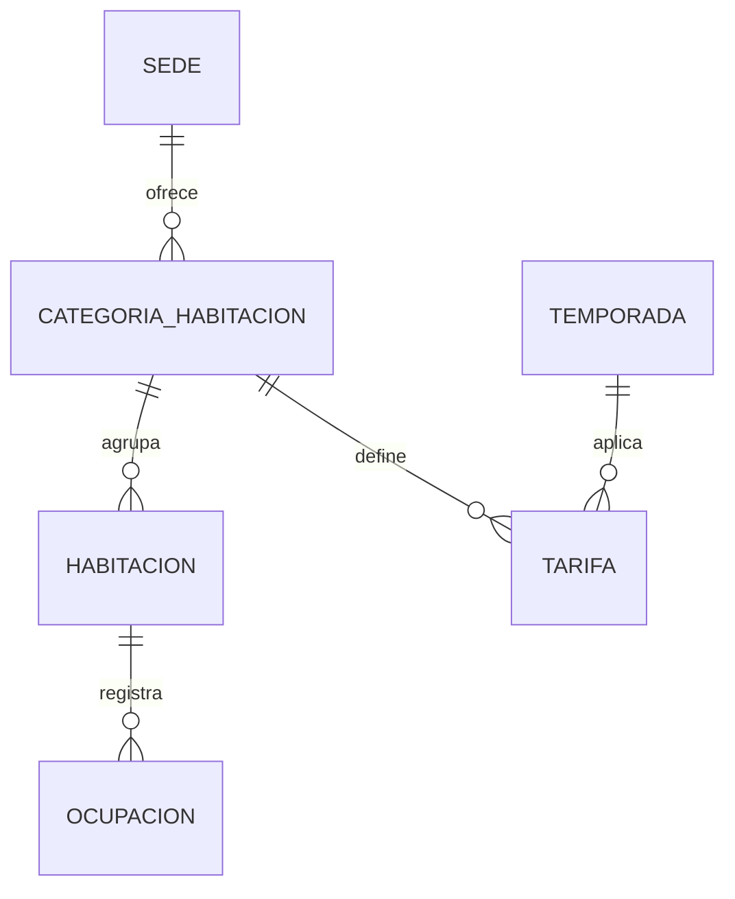
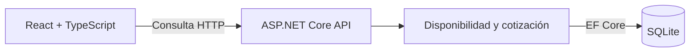

# SDD — Búsqueda de disponibilidad y tarifas

## Objetivo

Consultar las habitaciones disponibles para una sede, unas fechas y un número de huéspedes, y calcular el precio total de la estancia.

El slice incluye la API, la consulta a SQLite, la cotización y una interfaz web sencilla. No incluye crear reservas, pagos, autenticación ni CRUD administrativo.

## Inventario de prueba

| Sede | Tipo | Habitaciones | Capacidad máxima |
|---|---|---:|---:|
| Barranquilla | Estándar | 30 | 4 |
| Barranquilla | Premium | 3 | 4 |
| Cali | Premium | 20 | 6 |
| Cali | VIP | 2 | 6 |
| Cartagena | Estándar | 10 | 8 |
| Cartagena | Premium | 1 | 8 |
| Bogotá | Estándar | 20 | 6 |
| Bogotá | Premium | 20 | 6 |
| Bogotá | VIP | 2 | 6 |
| **Total** | | **108** | |

Cada habitación tendrá un identificador único. El inventario se cargará como datos de prueba.

## Reglas de búsqueda

La consulta recibe sede, fecha de entrada, fecha de salida y número de huéspedes. El tipo de habitación es opcional.

- La entrada debe ser anterior a la salida.
- Los huéspedes deben ser un entero mayor que cero.
- La capacidad de cada habitación debe cubrir el número de huéspedes.
- La estancia comprende desde la entrada, inclusive, hasta la salida, exclusiva. La salida no cuenta como noche.
- Existe conflicto cuando `fechaEntrada < salidaOcupacion` y `fechaSalida > entradaOcupacion`.
- Se devuelven las categorías que tengan habitaciones disponibles, indicando la cantidad disponible y el precio de la estancia.

## Tarifas

El precio depende de la sede, el tipo de habitación, la temporada y el número de huéspedes, conforme a las reglas de cotización que se adopten para la prueba.

El total se calcula noche a noche, sin incluir la fecha de salida. Si la estancia cruza dos temporadas, cada noche utiliza la tarifa correspondiente. Como restricción de los datos de prueba, los períodos de temporada son disjuntos y no se superponen entre sí, garantizando que cada noche de la estancia corresponda a una sola temporada y tarifa.

El enunciado disponible no proporciona una tabla oficial de precios ni un calendario comercial completo. Para probar el cálculo se usarán tarifas y períodos ficticios, identificados como datos demostrativos. Las reglas asumidas no se presentarán como políticas reales del hotel.

## Modelo de datos

Se utilizarán las siguientes entidades:

- `Sede`: ciudad o sede del hotel.
- `CategoriaHabitacion`: sede, tipo y capacidad máxima.
- `Habitacion`: identificador y categoría a la que pertenece.
- `Ocupacion`: habitación y fechas de entrada y salida.
- `Temporada`: nombre y período de vigencia.
- `Tarifa`: categoría, temporada, número de huéspedes e importe por noche.

La categoría identifica la combinación de sede y tipo de habitación. Así se pueden representar capacidades y tarifas diferentes para una misma categoría en distintas sedes.

## Componentes

## Criterios de aceptación

1. Una búsqueda válida devuelve las categorías disponibles y su cotización.
2. Se rechazan fechas iguales o invertidas y cantidades de huéspedes no válidas.
3. No se ofrecen habitaciones con capacidad insuficiente.
4. Una ocupación superpuesta excluye la habitación afectada.
5. Una ocupación que termina el día de entrada o empieza el día de salida no genera conflicto.
6. Si todas las habitaciones están ocupadas, la cantidad disponible es cero.
7. La tarifa cambia según la temporada y los parámetros definidos para la cotización.
8. Una estancia que cruza temporadas suma el importe correspondiente a cada noche.

## Tecnologías

- Backend: ASP.NET Core con .NET 8.
- Frontend: React y TypeScript.
- Persistencia: SQLite con Entity Framework Core.
- Pruebas: xUnit para las reglas de negocio.

Los diagramas describen el diseño previsto; la implementación y sus resultados se comprobarán durante el desarrollo.
