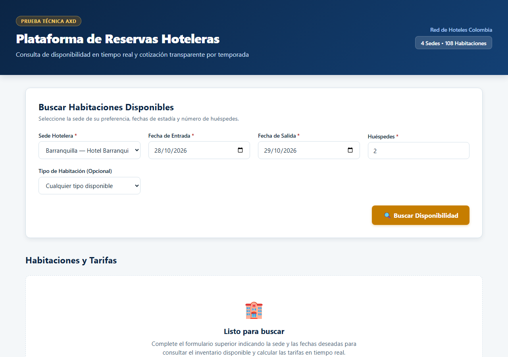
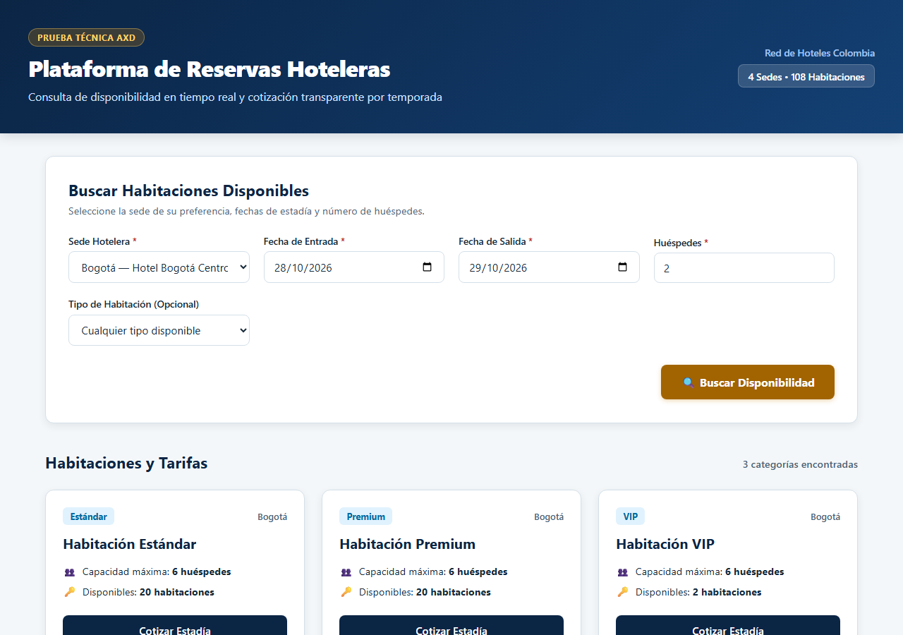
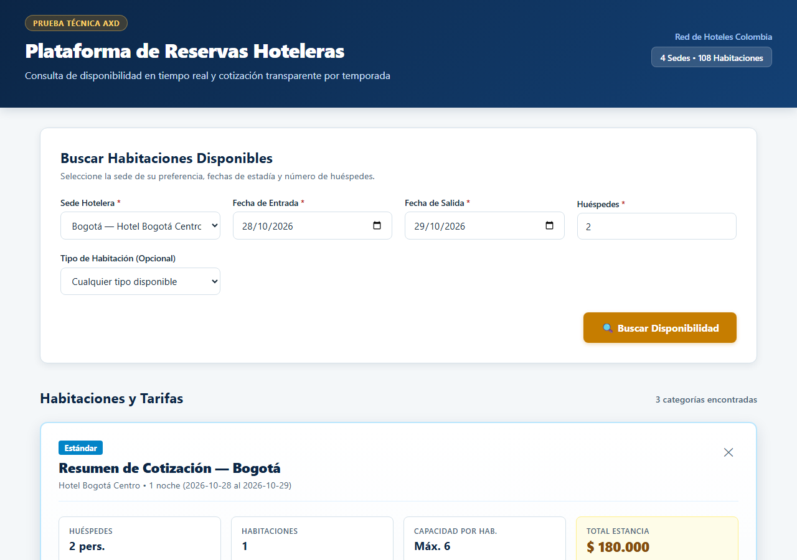
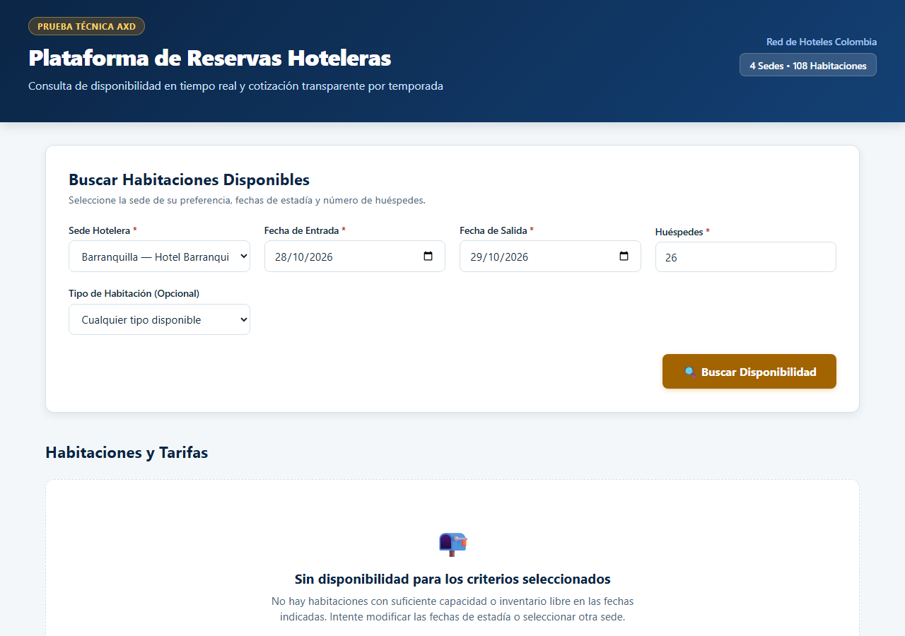

# Evidencias visuales de la aplicación

Capturas reales de la interfaz web en funcionamiento interactuando con la API y SQLite:

1. **Pantalla inicial de búsqueda:** Formulario de consulta con fechas y sedes por defecto.
   

2. **Resultados de búsqueda válida:** Disponibilidad en tiempo real para Bogotá con habitaciones Estándar, Premium y VIP.
   

3. **Cotización detallada:** Desglose de noches, tarifas por temporada y total estimado para habitación Estándar.
   

4. **Estado sin disponibilidad:** Mensaje informativo cuando la consulta excede la capacidad de las habitaciones de la sede.
   
